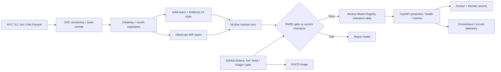

# TaxiOps

**End-to-end NYC yellow-taxi fare estimation MLOps service** using real monthly taxi records, data versioning, month-separated validation, MLflow experiment tracking and registry, a FastAPI inference API, Docker, GitHub Actions, and real-data drift measurements.

> Status: **locally tested and cloud-verification-ready, not yet a claimed deployed benchmark**. The full monthly-data, Docker Compose, MLflow registry, and Locust workflow runs on a GitHub-hosted machine once you push to `main`. Until the run succeeds, its numbers and live deployment URL remain unverified.

## What it predicts, and what it doesn't

TaxiOps estimates `fare_amount` (base fare in USD), **not** tips, tolls, or the final charged total. Inputs are estimated trip distance (miles), pickup/drop-off TLC zone IDs, passenger count, and pickup time. At quote time, the distance must be estimated by a routing system; TaxiOps does not implement routing. No other post-trip monetary values enter the feature set.

Training uses **January 2025** NYC yellow-taxi records; validation uses **February 2025**. Cleaned rows are *uniformly sampled across each month*, not sorted by time and truncated. We discard out-of-range observations rather than silently treating them as reliable ground truth. NYC TLC warns some source data may contain inaccuracies.

Official source: https://www.nyc.gov/site/tlc/about/tlc-trip-record-data.page

## Architecture



## No local Docker required: GitHub-hosted end-to-end verification

You can run the **actual multi-container, real-data project on a GitHub Actions Linux runner**. No Docker installation, memory-intensive XGBoost run, or large data download is needed on your laptop.

1. Create an empty GitHub repository named `TaxiOps` with **no starter README or `.gitignore`**, and upload/push the contents of this folder to its `main` branch. If you use Git on another machine, `git init`, `git add .`, `git commit`, then push to `main`. Do not push Parquet files or cached data.
2. Open the repository's **Actions** tab. Workflow **TaxiOps CI and image release** starts automatically for the new `main` push (or click **Run workflow** to retry).
3. Check the `quality`, `cloud-verification`, and `publish` jobs. When all pass, download the `taxiops-cloud-verification` artifact for the **measured** training report, JSON benchmark ledger, HTML/CSV Locust results, registered model backup, and DVC metadata. The same workflow publishes a runtime image to `ghcr.io/<owner>/taxiops:latest` after successful validation.

The cloud job downloads the *real official monthly data*, creates DVC pointers and a local DVC remote on its runner, builds/runs the actual Docker Compose FastAPI + MLflow services, tunes **15 XGBoost configurations** using January training and February validation (**50,000 sampled rows per month**), logs and registers the champion, smoke-tests the real model via `/predict`, benchmarks with Locust, records Docker image size, and preserves evidence as an Actions artifact. The complete raw Parquet datasets are **not** included in the repo or artifact; re-download them from TLC to reproduce DVC metadata. The local DVC remote is ephemeral on the runner; use S3 for a durable shared DVC remote.

**Important limitations:** The Github-hosted MLflow database from the cloud check is an **ephemeral verification registry**, not a continuously running production registry. The job backs up the registry and model artifacts for inspection/replay. The GitHub PR regression gate requires a separately provisioned, authenticated, persistent MLflow registry containing the deployed champion (see below). GitHub Actions benchmarks measure **GitHub-hosted compute**, not Render/cloud production latency. **No live Render URL exists** until you provision a cloud service in your own account. Free Actions quotas and other usage limits may apply.

No test count, RMSE, p95, RPS, Docker size or real MLflow run count should be claimed before the cloud job succeeds. The local `test_xgboost_integration.py` fits a **synthetic fixture only**; it is not evidence of TaxiOps accuracy on NYC trips.

## Run locally in 3 commands

**Prerequisites:** Python 3.11 or 3.12, Git, and Docker Desktop (Linux containers, running). Use PowerShell inside the extracted `TaxiOps` folder; each line below is one command. The second command downloads two **large official datasets**, so check free disk space first. Docker also needs disk space for the MLflow/XGBoost image.

```powershell
python -m pip install -e ".[train,dev]"
python scripts/bootstrap_data.py
python scripts/run_local.py
```

What happens: bootstrap initializes Git and DVC if needed; downloads Jan and Feb unchanged to `data/raw/`; tracks them with `.dvc` pointer files; stores bytes in `.dvcstore/` (local remote). Run-local builds two services, starts the MLflow server, performs **15 real MLflow tuning runs**, compares RMSE with a training-mean baseline, registers the winning pipeline as `TaxiOpsFare@champion` if it passes the gate, and smoke-tests the API.

Local URLs after successful training:
- API documentation: http://127.0.0.1:8000/docs
- Health: http://127.0.0.1:8000/health
- Prometheus metrics: http://127.0.0.1:8000/metrics
- MLflow experiment UI: http://127.0.0.1:5000

If you prefer manual steps: `docker compose up -d --build`, then `python -m taxiops.train --trials 15`. The compose MLflow service is bound to localhost on port 5000; the API is bound to localhost on port 8000.

### Example inference

```powershell
$body = @{ trip_distance=4.5; passenger_count=1; pickup_zone_id=161; dropoff_zone_id=237; pickup_hour=15; pickup_weekday=2; pickup_month=2 } | ConvertTo-Json
Invoke-RestMethod -Method Post -Uri http://127.0.0.1:8000/predict -ContentType 'application/json' -Body $body
```

`GET /health` reports `awaiting_model` until the *first successful inference* lazily loads the registered champion. It returns HTTP 200 for process liveness; `/predict` returns HTTP 503 if a champion cannot be loaded. Pydantic returns HTTP 422 for invalid inputs. The API caches the champion model for process lifetime; restart API containers to pick up an updated alias.

## Data versioning and provenance

After `bootstrap_data.py` completes, **commit** the DVC metadata, not the Parquet binaries:

```powershell
git add .gitignore .dvc .dvcignore data/raw/*.dvc pyproject.toml
git commit -m "Version Jan and Feb 2025 NYC TLC data using DVC"
```

The default `localstore` remote is useful for local experiments but **is not shared with a new computer or GitHub Actions**. To make source data reproducible across machines, configure an S3 DVC remote and run `dvc push` after arranging credentials:

```powershell
python -m pip install "dvc[s3]>=3.5,<4"
dvc remote add -d -f shared s3://YOUR_BUCKET/taxiops-data
dvc push
```

Do not commit AWS credentials, `.env`, large Parquet files, MLflow storage, or cloud secrets. The CI workflow below intentionally downloads the two public Parquet files afresh; the DVC pointers provide the reviewable provenance and S3 can be configured for larger production workflows.

## Training, validation, and the model gate

`python -m taxiops.train --max-rows 50000 --trials 15` creates 15 tuning runs **plus** a selected-model run when promoted. Each tuning run logs parameters, validation RMSE, the naive baseline RMSE and a JSON artifact. The winning scikit-learn preprocessing/XGBoost pipeline is registered with a `champion` alias.

On updates, the currently registered champion is loaded and evaluated against **the exact same validation sample** used for the candidate. If the new RMSE is larger, the gate fails and **no alias is changed**. Initially, when no champion exists, the project allows an explicit first promotion; in CI we use `--require-champion` to forbid accidental bootstrapping.

- **No target leakage:** `total_amount`, `tip_amount`, taxes, fees, and the target itself never appear in features.
- **Baseline:** constant prediction equal to the mean of *training* `fare_amount`; compare February RMSE.
- **Real distribution shifts:** two-sample KS statistics for trip distance and fare, Jensen–Shannon distances for pickup zone and hour.
- **Caveat:** because fare policy changes may affect predictions, compare both model performance and the underlying distributions; a drift statistic alone doesn't prove a model needs retraining.
- **Reproducibility:** fixed seeds, explicit month filter and sample cap; the same training procedure can be rerun on the same dataset snapshot. MLflow versions and library dependencies should be locked before a long-lived production release.

The JSON results are written to `outputs/training_report.json` and intentionally excluded from source control until real results exist.

## Tests and CI/CD

```powershell
ruff check .
pytest -q

docker build -t taxiops:dev .
```

GitHub Actions workflow: `.github/workflows/ci-cd.yml`.
- **Every PR:** Ruff, pytest, Docker image build, then train a bounded candidate on genuine Jan/Feb TLC data and **fail** if the champion wins on the same February sample.
- **Merge to `main`:** build and publish the runtime image to `ghcr.io/<owner>/<repo>:latest` and an immutable SHA tag.
- **Why the PR gate needs configuration:** the reference model lives in the *actual MLflow registry*, not a hard-coded fictional score. Under GitHub repo **Settings → Secrets and variables → Actions** configure variable `MLFLOW_TRACKING_URI` to your **public HTTPS, authenticated MLflow server**, and secrets `MLFLOW_TRACKING_USERNAME` and `MLFLOW_TRACKING_PASSWORD`. The workflow fails deliberately if these are not set; first promote a champion manually.
- **Security note:** GitHub does not supply regular repository secrets to untrusted fork PRs. Require checks on trusted branches or design a restricted, read-only gate service before accepting external PRs. PR workflows that can write experiment runs should use narrowly scoped MLflow credentials.

The local Docker Compose MLflow server is **not** reachable by cloud CI. A remote, authenticated MLflow endpoint is required for a real regression comparison.

## Deploy to Render

`render.yaml` defines two paid Render web services: a **public MLflow server protected by MLflow basic HTTP authentication**, backed by a persistent disk; and a **public FastAPI service** that accesses MLflow via Render's private network. This avoids losing model versions after a redeploy. Render currently requires a paid plan to attach a persistent disk.

1. Push this repository to GitHub. In Render, create a **Blueprint** from the repo and review estimated charges.
2. When prompted, set `MLFLOW_AUTH_ADMIN_PASSWORD` to a strong unique password (at least 12 characters); the server CSRF secret is generated automatically. Do **not** publish this credential or commit it.
3. Wait until Render provides the MLflow HTTPS address (`https://<your-mlflow-service>.onrender.com`); configure your **local** `MLFLOW_TRACKING_URI` to this URL and set `MLFLOW_TRACKING_USERNAME=admin` and `MLFLOW_TRACKING_PASSWORD` in your local environment. Run `python -m taxiops.train --trials 15` to register the champion in Render's persistent registry. **Then** test `https://<your-api-service>.onrender.com/predict`.
4. Add the remote MLflow URL and credentials to GitHub Actions settings to enable PR regression checks. Render can automatically redeploy the API from `main` after connecting the repository.

The deployed API URL is created **only after you actually provision the services**; no live URL is included or implied here. For real production systems, prefer PostgreSQL + durable S3/GCS artifact storage over single-instance SQLite, and avoid embedding administrator credentials in an API service (use least-privileged registry permissions).

## Load-test with real latency measurements

```powershell
python -m pip install -e ".[loadtest]"
locust -f loadtest/locustfile.py --host http://127.0.0.1:8000 --headless -u 10 -r 2 -t 2m --csv outputs/locust --html outputs/locust.html
```

Run only when the model is registered and `/predict` succeeds. To extract real numbers, use the `POST /predict` row in `outputs/locust_stats.csv` (`Requests/s`) and `outputs/locust_stats_history.csv` (histogram data / percentile columns) or the HTML report (`p50`, `p95`). Record a fixed user count and warmup, error rate, and number of API workers. Do not treat local and Render measurements as interchangeable.

For Docker image size: `docker image inspect taxiops:dev --format '{{.Size}}'` (size in bytes). Test count: `pytest -q` output. MLflow tuning run count: UI experiment list. Baseline and candidate RMSE: `outputs/training_report.json`. After benchmarking run `python scripts/collect_measurements.py` to create `outputs/benchmark_evidence.json`, leaving metrics without evidence as `null`.

## Benchmark ledger (fill in ONLY after running)

| Measurement | Actual result | Evidence |
|---|---|---|
| Jan train and Feb validation rows | Not measured | `outputs/training_report.json` |
| MLflow tuning runs | Not run; configured for 15 | MLflow UI / report |
| Automated pytest test count | 39 passed in the source/test environment | `pytest -q` |
| Baseline validation RMSE | Not measured | Training report |
| Best model validation RMSE | Not measured | Training report |
| Actual month-to-month drift statistics | Not measured | Training report |
| Docker image size | Not measured | `docker image inspect` |
| API p50 and p95 | Not measured | Locust reports |
| Successful requests per second | Not measured | Locust reports |
| Live Render API URL | Not deployed | Render dashboard |

## Project structure

```text
TaxiOps/
├── src/taxiops/
│   ├── api/app.py         # Pydantic requests, prediction, health and /metrics
│   ├── config.py          # Single shared feature schema
│   ├── data.py            # Read and clean real Parquet in bounded memory
│   ├── drift.py           # Distribution comparisons
│   ├── model.py           # Scikit-learn + XGBoost pipeline
│   ├── train.py           # MLflow tuning, validation, registration, promotion
│   ├── registry.py        # MLflow alias loading
│   └── metrics.py         # RMSE and regression gate logic
├── scripts/
│   ├── bootstrap_data.py # Git/DVC init + actual TLC data + push
│   ├── download_data.py  # Official source downloads
│   ├── run_local.py      # Docker + training + end-to-end smoke test
│   └── collect_measurements.py # Evidence-only benchmark summary
├── tests/                # Data, schema, API, model, drift and gate tests
├── loadtest/locustfile.py
├── Dockerfile             # Multi-stage, non-root container
├── docker-compose.yml    # MLflow + API
├── render.yaml           # Secured paid Render deployment blueprint
└── .github/workflows/ci-cd.yml
```

## Limits and next hardening steps

1. Remote data store: local DVC remote is not a shared backup. Configure S3 when adding team/cloud retraining.
2. Model controls: built-in MLflow admin credentials are a demonstration baseline, not least privilege. Restrict artifact and registry writes separately in production.
3. User inputs: strict Pydantic bounds catch malformed inputs but do not establish whether a trip is geographically possible or a distance estimate is realistic.
4. Drift: monthly shifts are real observations, not necessarily harmful; evaluate and compare model performance when monthly data changes.
5. Operational maturity: authenticated metrics, rate limits, request logging without passenger-identifying details, model lifecycle controls, and release rollback should be implemented before accepting unrestricted public traffic.